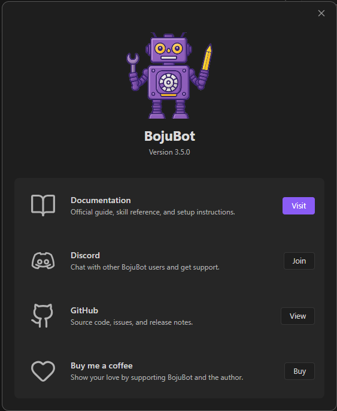
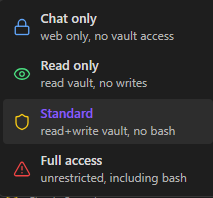

# Chat Panel

The chat panel opens as a sidebar. You can open several, as tabs or splits, each with its own session: see [Several sessions at once](./sessions#several-sessions-at-once). Type your message and press **Enter** to send. Use **Shift+Enter** to insert a newline without sending. 

If you would prefer to exclusively use the **Up Arrow** icon to send messages rather than the **Enter** key, the "Send on Enter" behavior can be toggled in **Settings → BojuBot → Send On Enter**.

Replies stream in word by word as the agent writes them, then switch to fully formatted markdown when each reply is complete. To get a whole block at a time instead, turn off **Settings → BojuBot → Stream replies as they're written**. On Claude Code, live streaming needs a version that supports it; on older versions replies arrive a block at a time either way.

In **Standard** permissions mode, the agent has access to your full vault — it can read, write, create, move, and organize notes. The vault root is the agent's working directory.  You can confirm this by typing, "What is your current working directory?"

---

## Welcome Screen

Starting a new session (or opening the panel with no active conversation) shows a welcome screen: BojuBot's mascot, a greeting, a tip of the day, and — once you have past conversations — a **Recent sessions** list of up to three, click any to resume (**More…** opens the [Sessions panel](./sessions#sessions-panel) with all of them). A session you haven't typed in yet shows the welcome screen again whenever you come back to it. The header shows which agent and model the session uses (BojuBot's version is in the [About dialog](#about-dialog)). Click the mascot to open the About dialog.


A small **♥ Support BojuBot** link sits at the bottom of the welcome screen.

Once in a while, for people who use BojuBot regularly, the mascot and greeting are replaced by a short note from the author about supporting the project. It appears at milestones: after your 10th, 20th, 30th and 50th sessions, then every 50th. Only sessions that actually got a reply count, so clicking **+** doesn't. Each milestone shows once, never twice in one day, and only if you've used at least three other sessions in the past month, so it never greets someone returning after a long break. It never blocks anything; just start typing. Tick **I already donated** on the note, or turn on **Settings → Hide the support message**, and neither the note nor the link will appear again. See [How you can support](https://www.scottkirvan.com/BojuBot/support) for all the ways to help.

When you thank the agent for its help, a small note from the author may appear under the reply: usually a personal thank-you, sometimes a pointer to other ways to help or, now and then for regular users, a gentle support link. It shows at most once per session and once a day, and never when you've turned off the support message. The agent only notices the thank-you; the note's words are the author's own.

---

## About Dialog

The **Help & resources** dialog is the place to go when you're stuck. Open it with the help icon in the toolbar, `/help` in the chat, the **BojuBot: Open help & resources** command, or by clicking the mascot on the welcome screen.

- **Version information**: BojuBot's version, when the build was made (and the branch it was built from, unless that's `main`), and the version of each agent CLI you have installed. **Click it to copy everything to the clipboard**, ready to paste into a bug report or a Discord message.
- **Documentation**, **Get help on Discord**, **Report a problem** (see [Reporting a problem](#reporting-a-problem)), and **Buy me a coffee**.
- Small icons at the bottom: **What's new** (the [changelog](https://www.scottkirvan.com/BojuBot/changelog)), **Credits**, **Privacy** (the [privacy policy](https://www.scottkirvan.com/BojuBot/privacy)) and **GitHub**.

**Credits** rolls slowly like the end of a film: the projects and people BojuBot builds on. When the last line reaches the middle it fades out and starts again. Scroll or click it to stop the roll and read at your own pace. If your system has reduced motion turned on, it's a plain list.
 
 

## Reporting a problem

Found a bug, want a feature, or have feedback? Open **Report a problem** from the Help & resources dialog, `/bug` in the chat, the **BojuBot: Report a problem** command, **Settings → Help & feedback**, or the **Report this problem** link on an error message.

Give the report a short **Title** (it becomes the issue's title) and a **Description**. For a bug, the description is most useful with the steps that make it happen, so it can be reproduced.

The **Details** are filled in for you: BojuBot's version and build, your installed agents, the session's agent and model, your OS, and the error if you opened it from one. Everything is editable, so remove anything you'd rather not share. You can also include the last lines of the debug log (turn on **Settings → Logging** first); they're shown for editing too, because logs can contain note names and parts of messages.

- **Send** files the report as a GitHub issue for you; you don't need a GitHub account. When it's done, the form shows a link to the issue so you can follow replies.
- **Open on GitHub** opens the report as a new GitHub issue, ready for you to submit.
- **Copy report** copies it to the clipboard, to paste on Discord or in an email.

Reports are public GitHub issues, so anyone can read them. Nothing is sent until you click **Send**. If sending fails (you're offline, or too many reports came from your network in the last minute), the form says why and keeps your report, so you can try again or use **Open on GitHub** or **Copy report** instead. See the [privacy policy](../privacy#network-requests-bojubot-makes) for what Send shares.

### Asking the agent to report it

You can also ask the agent, for example "file a bug: the gauge doesn't update after compacting". It opens the form with the type, title and description filled in, including steps to reproduce when it knows them. Check and edit it, then click **Send** yourself: the agent can open the form but never send it. This works in every permission mode, and a [skill](./skills) can ask for it too.

White-labeled installs don't have **Send**; their reports go to the brand's own repository through **Open on GitHub**.

## Attaching Context

Attached items appear in a bar above the input field. Click **×** to remove an item, or the **pin icon** to keep it attached for every subsequent message in the session.
### @-mention a note

Type `@` anywhere in the input to open an autocomplete dropdown.  Press **Enter** to attach it the highlighted note. Start typing to filter by name. Press **↑ / ↓** to navigate, **Enter** or **Tab** to select, **Escape** to dismiss. The full contents of the selected note are prepended to your message.

Non-Markdown files show their extension in the dropdown. By default all vault files are included. To restrict to specific types, change **@-mention file types** in [Settings](./settings.md).

### Attachment button (paperclip)

| Option          | What it does                                                                                                                                                      |
| --------------- | ----------------------------------------------------------------------------------------------------------------------------------------------------------------- |
| **Attach file** | Opens your system file picker. Text files (`.md`, `.txt`, `.js`, etc.) are read inline. Images and PDFs are copied to a temporary folder so the agent can read them. |
| **Attach URL**  | Passes a URL to the agent as-is. The agent fetches or references it based on your message.                                                                        |
| **@ Add note**  | Opens the same vault note search as the `@` shortcut.                                                                                                             |

### Paste from clipboard

Paste images directly with **Ctrl+V** / **Cmd+V**:

- **Screenshots** — take a screenshot, paste into BojuBot
- **Files from Explorer/Finder** — copy a `.png`, `.jpg`, `.gif`, `.webp`, or `.pdf` and paste

Pasted images appear in the context bar. They're saved to `.obsidian/plugins/bojubot/tmp/` and are not automatically cleaned up.

### Drag and drop

Drag any file from your filesystem and drop it onto the BojuBot panel. The panel highlights with a dashed border while dragging. Text files are read inline; images and PDFs are handled the same as the file picker.

### Send selected text

Highlight text in any open note, then run **BojuBot: Send selection as context** from the Command Palette (or bind it to a hotkey). The selection is attached as a labeled snippet.

---

## Permission Icon

Click the colored **Permission Icon** in the input toolbar to open a quick picker and switch the permissions mode:



The change takes effect on the next message. See [Permissions](./permissions.md) for details on what each mode allows.

---

## Model Indicator

The **model indicator** in the input toolbar shows the session's agent and model, with the agent's icon, e.g. *✳ Claude · Claude Sonnet 5.5*. Click it to open the agent + model picker. It has one section per agent, headed by its name; an agent that isn't installed is greyed out with *not installed*. The Antigravity CLI also offers Claude models, so the same model name can appear under both agents: they're different choices, run by different agents.

What picking does:

- **A model of the session's agent** switches the model mid-session (see below).
- **Another agent's model, in a session you haven't sent a message in yet**, moves the session to that agent.
- **Another agent's model, in a session with messages**, starts a new session on that agent and model in the same tab, with a notice. Your previous session stays in the Sessions panel. The new session keeps the old one's permission mode; if the new agent doesn't offer it, it gets the nearest mode with less access (never more).

Picking a model also makes it, and its agent, what new sessions start with.

For **Claude (Claude Code)** sessions, the built-in models are:

| Model         | Best for                         |
| ------------- | -------------------------------- |
| Claude Haiku  | Fast responses, simple tasks     |
| Claude Sonnet | Balanced speed and capability    |
| Claude Opus   | Complex reasoning and long tasks |
| Claude Fable  | Long-running agents              |

For **Gemini (Antigravity CLI)** sessions, the picker lists the models the Antigravity CLI offers: Gemini, plus some Claude and GPT-OSS models. See [Choosing an Agent](./agents#what-s-different-with-gemini).

You can switch models **mid-conversation** — the session continues with its full history, and the new model takes over from your next message. This is handy for getting a second opinion: work through a problem with one model, then switch to another to review the result without re-explaining everything.

The selected model also becomes the default for new sessions on that agent and persists across restarts. If the session was started as a [Custom session](./sessions.md#starting-a-new-session) with its own pinned model, switching updates that session's model too.

::: tip
On Claude Code, the first message after a switch costs more than usual: prompt caching is per model, so the new model reads the conversation history uncached once. Later messages are cached again.
:::

You can also open the picker with `/model` in the slash menu or **BojuBot: Switch model** in the Command Palette.

To add Claude Code models not in the built-in list, see [Custom models](./settings.md#custom-models) in Settings.

### Effort

Effort controls how much thinking the model does on each turn — lower is faster and lighter on your plan or quota, higher reasons more deeply on hard problems. Click the **gauge icon** next to the model name to pick a level. When a level other than **Default** is active, the model indicator shows it, e.g. *Claude · Claude Sonnet 5.5 · high*. Each agent keeps its own effort default. On Gemini, the picker offers only the levels the session's model has (GPT-OSS 120B has Medium only); a level the model doesn't have falls back to its nearest one.

| Level       | What it means                                     |
| ----------- | ------------------------------------------------- |
| **Default** | Let the agent choose (no level is sent)           |
| low         | Fastest replies, least thinking                   |
| medium      | Balanced speed and depth                          |
| high        | Deeper reasoning for harder tasks                 |
| xhigh       | Extra thinking — slower, uses more of your plan   |
| max         | Most thinking — slowest, uses the most of your plan |

The list comes from the session's agent CLI, so it may differ between agents and versions. If the CLI doesn't support effort levels (older Claude Code versions, for example), the gauge icon and the effort commands are hidden.

Like a model switch, an effort change applies from your **next message** and the session continues. The chosen level also becomes the default for new sessions. A [Custom session](./sessions.md#starting-a-new-session) can pin its own level; switching mid-session updates that pin too.

You can also switch via `/effort` in the slash menu or **BojuBot: Switch effort** in the Command Palette.

---

## Plan Usage

Choose **Usage** from the `/` menu (or run **BojuBot: Show plan usage** from the Command Palette) to see how much of your plan or quota you've used. The report appears as a card in the chat, and depends on the session's agent:

- **Claude (Claude Code):** how much of your Claude plan you've used — the current session and current week percentages and when they reset, plus Claude Code's breakdown of what's contributing.
- **Gemini (Antigravity CLI)**: the remaining weekly and 5-hour quota for each Antigravity model group.

Checking usage is free: it runs the agent CLI's own `/usage` command in a separate process, so it isn't sent to the model, doesn't become part of your conversation, and doesn't affect the context gauge. You can check it while the agent is still replying.

---

## Context Gauge

*Claude (Claude Code) sessions only.* A **ring icon** appears in the input bar after your first message. Hover to see how much of the 200K token context window remains. Click it to manually compact the session history if it's filling up.

Gemini sessions don't show the gauge, because the Antigravity CLI doesn't report its context size or offer a compact command.

---

## Tool Call Visibility

While the agent is working, tool calls appear above the response bubble in real time — you can see what it's reading, writing, or searching. When the response completes, the tool list collapses to a single toggle line. Click to expand or collapse.

---

## Running Obsidian Commands

The agent can execute Obsidian commands directly. Three are pre-approved by default:

| Command                   | ID                   |
| ------------------------- | -------------------- |
| Quick switcher            | `switcher:open`      |
| Daily notes: Open today's | `daily-notes`        |
| Search current file       | `editor:open-search` |

You can manage the full list in **Settings → BojuBot → UI Bridge & Commands**.

Commands only run in **Standard** and **Full access**. In Chat only and Read only, BojuBot blocks them (with a notice), because commands can create or change notes.

### How permission works

| Situation                                     | What happens                                              |
| --------------------------------------------- | --------------------------------------------------------- |
| Command in **allowlist**                      | Runs immediately                                          |
| Command **not** in allowlist (prompt mode on) | Modal appears: Allow or Deny, with **Don't ask again**    |
| Allow + Don't ask again                       | Runs and added to allowlist permanently                   |
| Deny + Don't ask again                        | Added to denylist — future attempts silently blocked      |
| Command in **denylist**                       | Silently blocked (add to allowlist to re-enable)          |
| Prompt mode off                               | Unlisted commands hard-blocked with an explanatory notice |

---

## Opening & Navigating Files

The agent can open a note directly in your workspace as part of its response — for example, after creating or finding something you'll want to look at:

| Behavior             | What happens                                          |
| --------------------- | ------------------------------------------------------ |
| Open in current pane  | Replaces what you're currently viewing                 |
| Open in a split       | Side-by-side, doesn't disturb your current view        |
| Open in a new tab     | Stacked tab — doesn't replace or split anything         |
| Jump to a heading     | Opens the file and scrolls to a specific heading        |

All of these are immediate — no confirmation needed — and the agent posts a short notice each time, so you always know what changed. They work in every permission mode, including Chat only: they only change what's on your screen and send nothing back to the agent.

---

## Other Actions

A few smaller things the agent can do as part of a conversation:

- **Change how it addresses you (or itself)** — just say so, e.g. *"Call me Alex from now on"* or *"I'd rather you go by a different name."* Persists across sessions.
- **Request permission** — if a task genuinely needs a capability your current permission mode blocks (e.g. a shell command that changes files, which Standard mode denies), the agent can ask instead of giving up silently. You decide via the denial card on your next message — see [Permission Denials](./permissions.md#permission-denials).
- **Open Settings** or **the quick switcher** — the agent asks first in chat text, waits for you to confirm, then acts on your next message. Never fires without that round-trip.

---

## File Operations

The agent can rename, move, and delete vault files through Obsidian's own API rather than the filesystem directly — so wikilinks and embeds pointing at the file update automatically instead of breaking.

- **Delete** moves the file to trash per your vault's configured trash preference (system trash or `.trash/` folder) — it's not a permanent delete.
- Requires **Standard** or **Full access** permission mode. In Chat only or Read only mode these are no-ops — the current mode doesn't allow vault writes, so nothing happens (with a notice explaining why).

---

## Example Prompts

```
"Summarize the note [[Project Alpha]]"
"Find all notes tagged #meeting from last week and create a summary"
"Rename all notes in 03_Cards that start with 'Untitled' based on their content"
"Open today's daily note"
"Refresh the Dataview on this page"
"Create a new note from my Project template"
```
