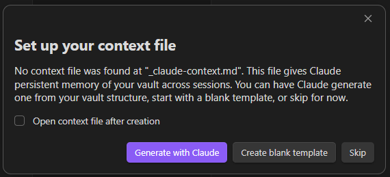
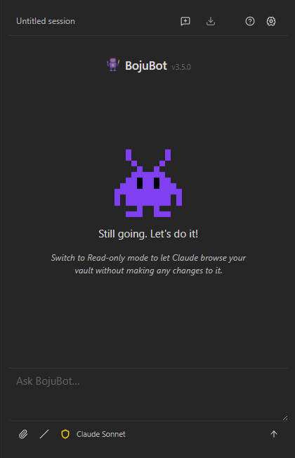

# First Launch

After enabling the plugin:

- A **brain-circuit icon** appears in the left ribbon — click it to open the BojuBot chat panel
- Or use the Command Palette (`Ctrl+P` / `Cmd+P`): **BojuBot: Open agent panel**

BojuBot uses Claude Code (Claude) unless you pick another agent. To use Gemini instead, choose **Antigravity** in **Settings → BojuBot → Agent** first (see [Requirements & Installation](./getting-started#installing-antigravity-for-gemini)). The welcome screen shows which agent and model a session uses.

::: tip Agent not found?
If BojuBot can't find your agent's CLI, a setup panel appears instead of the chat. For Claude Code, follow the on-screen steps to install it, or enter the full path to your `claude` binary in **Settings → BojuBot → Claude binary path**. For Gemini, install Google's Antigravity CLI (`agy`) or set **Antigravity binary path**. Then click **Check again**.

If you only installed Antigravity for Gemini, you'll see the Claude Code setup panel until you switch **Settings → BojuBot → Agent** to **Antigravity**.
:::

The first time BojuBot doesn't find a context file, a setup dialog offers to have your agent generate one, start from a blank template, or skip — see [Context File](./context-system#3-context-file-persistent-memory) for details.

Every new session also shows a brief welcome screen (mascot, greeting, tip of the day, recent sessions) — see [Welcome Screen](./chat-panel#welcome-screen).

Once the panel opens, type a message and press **Enter**. Your context file (if you have one) is injected at the start of each session so the agent isn't starting blind.

**Try these to get a feel for it:**

- *"Tell me about yourself"*
- *"Summarize the note [[Home]]"*
- *"What notes do I have tagged #meeting from last month?"*
- *"Create a new note in 'Planning' called 'Q2 Goals' with a bullet outline"*

---

Next: [Using the Chat Panel →](./chat-panel)
